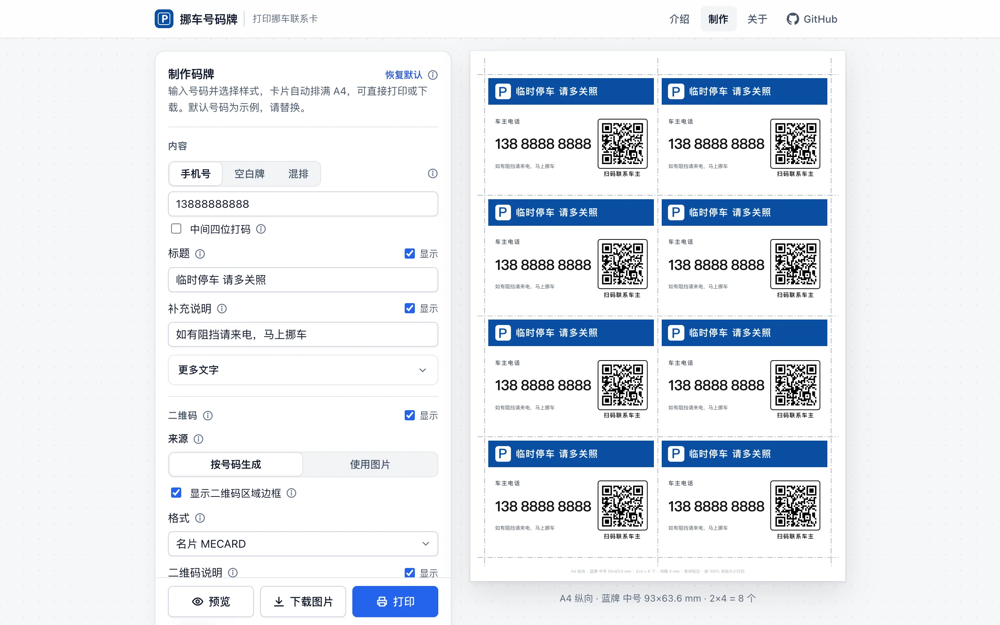
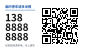

# 挪车号码牌 · Parking Contact Card

在线制作挪车联系卡：输入手机号，选一种样式，卡片自动排满 A4，带拨号二维码和裁切线，打印后沿线裁开即可放在车内。

纯静态网页，无需注册、无需服务器；号码只保存在本机浏览器中，访问过一次后可离线使用。



## 样式


| 蓝牌                                  | 极简名片                                  | 警示牌                                    |
| ----------------------------------- | ------------------------------------- | -------------------------------------- |
|  |  |  |
| 顶部色条 + 二维码，最常用                      | 名片比例，信息克制                             | 黄黑斜纹，远处可见                              |


| 竖版吊牌                                 | 挡风长条                                   | 空白牌                                   |
| ------------------------------------ | -------------------------------------- | ------------------------------------- |
|  |  |  |
| 可打孔挂在后视镜                             | 横贴在挡风玻璃下沿                              | 不印号码，打印后手写                            |


每种样式都有黑白、彩色两种配色；标题、补充说明、号码标签、标志、二维码说明都可修改或关闭，标志可换成自己的图片。

## 功能

- **自动排版**：大、中、小三档尺寸，按纸张计算每张 A4 最多能排几张（2–21 张，视样式与尺寸而定），自动选择纸张方向。
- **裁切标记**：
  - 共用裁切线：卡片间距 4 mm，相邻两张卡共用一条线，一刀裁开一整排；
  - 角线：卡片间距 7 mm，每张卡四角画短线，支持出血；
  - 也可以不画。所有标记都不压在卡片上。
- **卡片边缘**：贴边、出血 1.5 mm、白边 2 mm 三种；可加 0.3 mm 细线边框（实线 / 虚线 / 宽虚线，圆角 / 直角）。
- **二维码**：名片 MECARD / vCard（扫码弹出联系人）、`tel:` 直接拨号、网址 → 拨号页，或使用自己的二维码图片。
- **可读性提示**：按实际尺寸估算号码的可视距离和二维码的扫描距离，低于建议值时提醒。
- **空白牌**：不印号码和二维码，号码位置留出手写区（可选是否画横线）。
- **混排**：同一张纸上既印号码牌又印空白牌，设置空白牌张数即可；号码牌在前、空白牌在后，裁开后自然分成两摞。空白牌使用无二维码的版式。
- **输出**：直接打印；或下载 JPG（150 / 300 / 600 dpi）、SVG 矢量图，范围可选 A4 整张或单张卡片（混排时可单独下载空白牌）。
- **设置项说明**：每个设置旁的 ⓘ 显示说明，并在卡片示意图上用红圈标出对应位置。


## 使用

1. 打开页面，点击「开始制作」。
2. 输入手机号（或切换到「空白牌」「混排」），选择样式、尺寸和裁切标记，右侧实时预览整张 A4。
3. 点击「打印」。打印窗口中：边距选「无」，缩放选「100% / 实际大小」，勾选「背景图形」。
4. 沿裁切线裁开。

建议先用普通纸试印一张，用尺子核对成品尺寸，并用常用的扫码方式扫一次最小的那张。

### 二维码格式怎么选


| 格式                    | 扫码后                   | 适用             |
| --------------------- | --------------------- | -------------- |
| 名片 MECARD（默认） / vCard | 弹出联系人卡片，点号码拨打         | 多数手机相机         |
| `tel:`                | 直接进入拨号界面              | 支持 `tel:` 的扫码器 |
| 网址 → 拨号               | 打开拨号页，自动尝试拨号（微信内需点按钮） | 扫码器不认 `tel:` 时 |


「网址 → 拨号」需要把 `dial.html` 托管在 https 网址下（例如 GitHub Pages），在制作页填写该网址。二维码内容形如 `https://你的域名/dial.html?n=MTM4ODg4ODg4ODg%3D`，号码以 base64 编码写在 `n` 参数里，制作页可在弹层中预览拨号页（预览时不会拨号）。


> base64 只避免号码在网址中直接可见，不是加密；扫到二维码的人都能看到号码。「中间四位打码」也只遮挡卡片上肉眼可见的号码。


## 隐私

- 号码与设置只保存在本设备浏览器的 `localStorage` 中，不上传；二维码在本机生成。
- 没有账号、统计脚本和广告，页面不向第三方发送请求。
- 拨号页只读取网址中的号码参数。
- 页面所在的托管服务（如 GitHub Pages）可能记录常规访问日志，这与访问任何网站相同。


## 部署

纯静态文件，没有服务端代码。`npm run build` 生成只含线上文件的发布目录 `dist/`，并核对离线缓存清单。

- **Cloudflare Pages / Workers**：见 [docs/deploy-cloudflare.md](docs/deploy-cloudflare.md)（含两种接入方式、响应头 `_headers`、自定义域名、回滚）。
- **GitHub Pages**：见 [docs/deploy-github-pages.md](docs/deploy-github-pages.md)，可通过 `https://<用户名>.github.io/parking-contact-card/` 访问。
- **其他托管 / 自建服务器**：上传 `dist/` 的内容即可。离线缓存（Service Worker）只在 https 或 `localhost` 下生效；直接双击打开 `index.html` 也能使用，只是没有离线缓存。

本地预览：

```sh
python3 -m http.server 8000           # 源码目录，打开 http://localhost:8000/
npm run build && python3 -m http.server 8000 -d dist   # 发布目录
```


## 浏览器支持


| 环境                            | 状态                                         |
| ----------------------------- | ------------------------------------------ |
| Chrome / Edge（桌面）             | 已测试                                        |
| Safari 16+ / Firefox 121+（桌面） | 按所用特性应可用（容器查询单位、`:has()`、`<dialog>`），未逐项实测 |
| iOS Safari / Android Chrome   | 界面已按触屏适配                                   |


打印效果因打印机和驱动而异，正式使用前请试印。

## 开发


### 目录结构

```
index.html            产品介绍（默认）+ 制作页（#make）：样式、模板、脚本都在这一个文件里
dial.html             扫码打开的拨号页
version.js            版本号与编译号
sw.js                 离线缓存（Service Worker）
manifest.webmanifest  添加到主屏幕的应用信息
icons/                应用图标
assets/preview/       介绍页与 README 用的预览图（由脚本生成）
scripts/
  build-dist.sh       生成发布目录 dist/
  build-previews.js   生成预览图
  stamp-build.sh      把编译号写入源码 version.js（可选，发布不需要）
docs/                 部署文档（Cloudflare Pages、GitHub Pages）
_headers              Cloudflare Pages 响应头
.githooks/pre-commit  提交前调用 stamp-build.sh（可选，发布不需要）
```

没有框架和构建步骤；二维码生成使用内嵌的 [qrcodejs](https://github.com/davidshimjs/qrcodejs)（MIT）。

### 新增卡片样式

`index.html` 中每种样式是一个独立区块（`<style>` + `<template>` + `registerCardDesign({...})`），以注释 `样式：xxx 开始 / 结束` 标出。复制一个区块、修改 id 与样式即可新增；删除整个区块即可移除。字段约定见 `registerCardDesign` 的注释。

### 版本号与编译号

- `version.js` 中的 `PCC_VERSION`（语义化版本）在功能发布时手动修改。
- `PCC_BUILD`（编译号）在源码中保持 `dev`；`npm run build` 生成 `dist/` 时写入当前提交哈希的前 7 位（Cloudflare Pages、GitHub Actions 构建时同样如此），不需要手改，也不需要在本地设置提交钩子。
- 页脚和「关于」中显示 `v版本 (编译号)`；离线缓存按 `版本+编译号` 区分，每次发布编译号都会变化，用户的离线缓存随之更新。

### 重新生成预览图

修改样式或界面后：

```sh
npm install
npx playwright install chromium
npm run previews
```

已安装 Chrome 时可不下载浏览器：

```sh
PCC_CHROME="/Applications/Google Chrome.app/Contents/MacOS/Google Chrome" npm run previews
```


### 发布前检查

项目没有自动化测试，发布前建议手动核对：

- 5 种样式 × 3 档尺寸在横向、纵向纸张上的排版与裁切线；
- 打印一张，用尺子核对成品尺寸；
- 用手机相机扫描各二维码格式，确认能拨号或弹出联系人；
- 托管后访问一次，断网刷新确认离线可用。


## 反馈

问题与建议请提交到 [Issues](https://github.com/KangSpace/parking-contact-card/issues)。

## 许可证

[MIT](LICENSE)。内嵌的 [qrcodejs](https://github.com/davidshimjs/qrcodejs) 同为 MIT 许可。